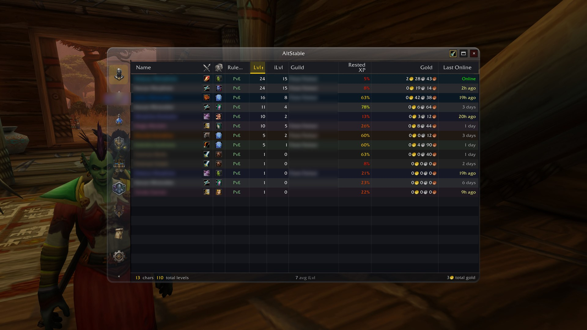
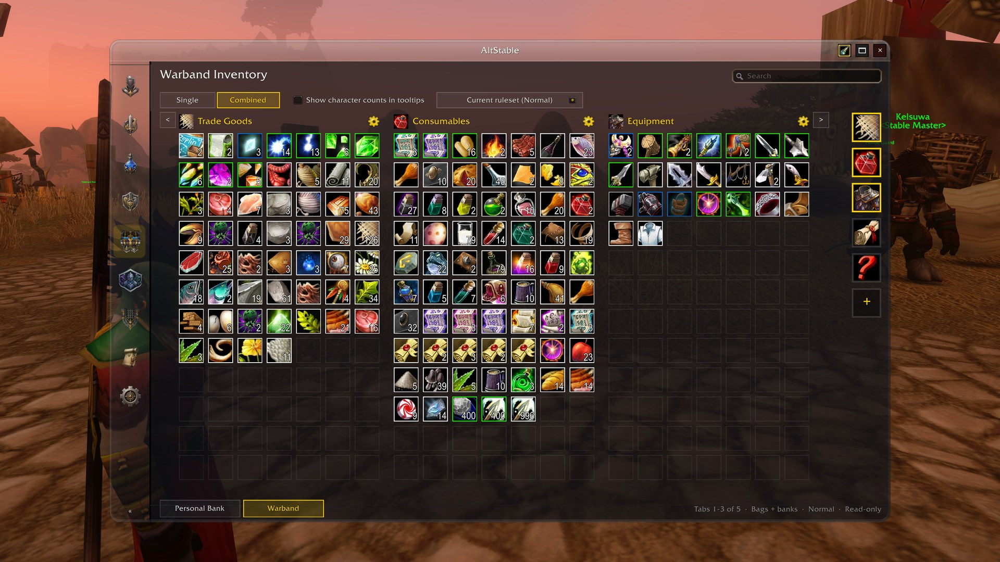
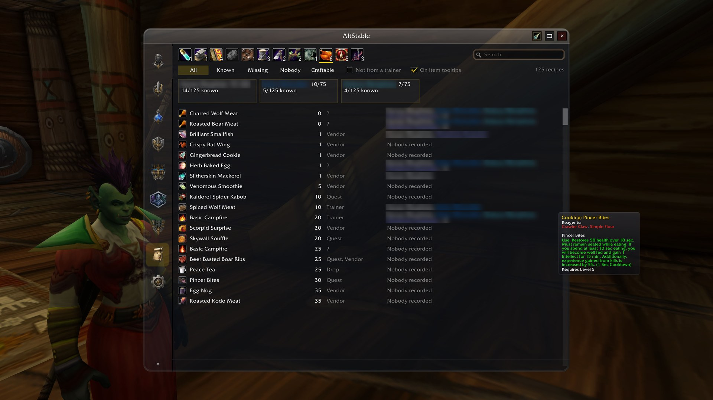
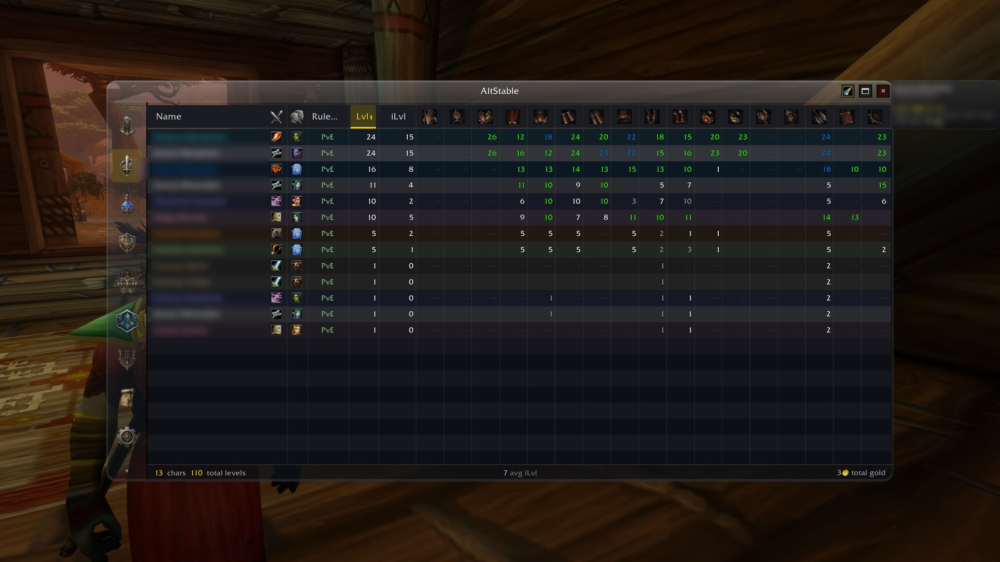
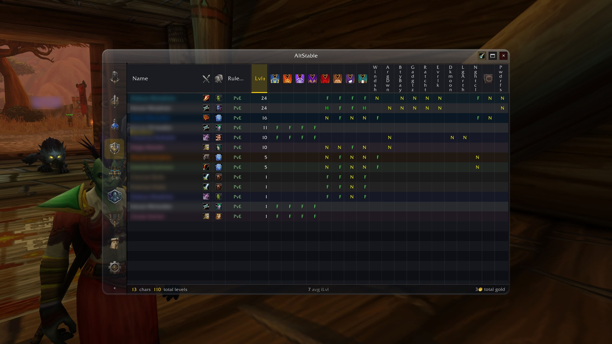
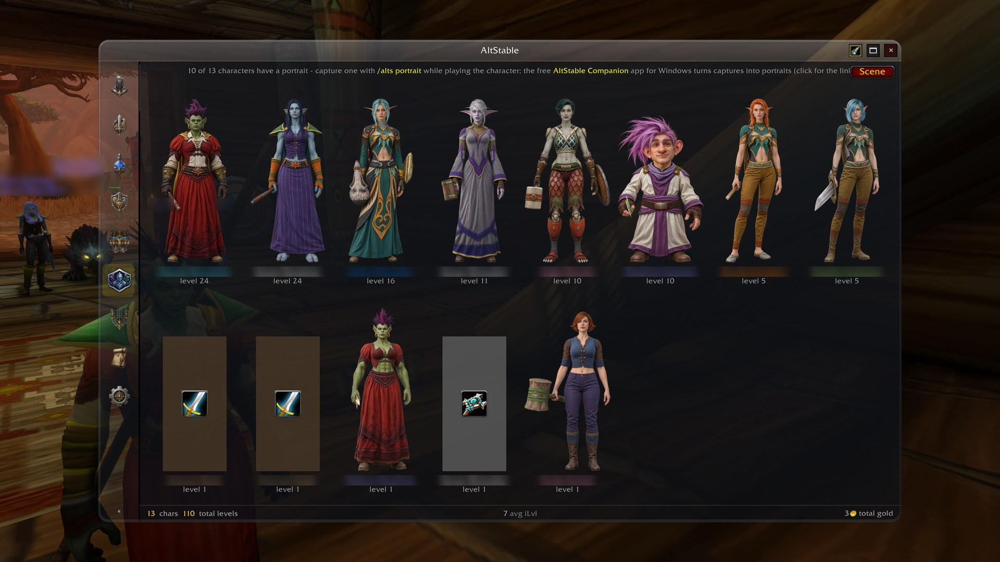
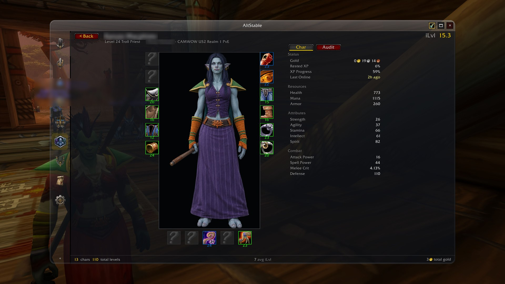
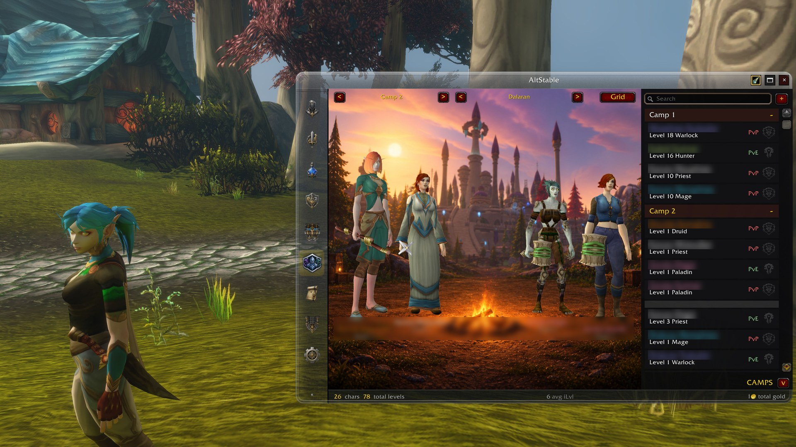
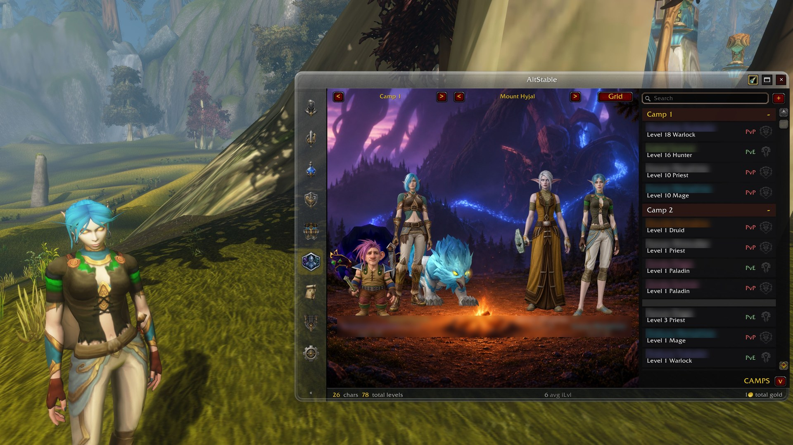

# AltStable — Alt Tracker (Altoholic Alternative)

**For World of Warcraft: Forever.**

Looking for an Altoholic alternative for WoW Forever? AltStable brings your characters' gear,
inventory, professions and progression together in one window, so you can check what your alts
have without logging into each of them.

Everything below works with the addon on its own. Character portraits for the Roster are an
optional extra that needs the free [AltStable Companion](#optional-character-portraits-and-the-companion)
app.

*The sheet: every character at a glance, with total levels, average item level and total gold
along the bottom. (Names blurred in all screenshots.)*

## What AltStable helps you do

What you see for another character is what AltStable **recorded** the last time you played it
(or the last time it synced). Only the character you are on is live. Seeing an item on an alt
doesn't move it anywhere, and whether you can pass it on still depends on the game's own rules.

### Which alt has my materials?

The **Warband** tab lays out every item in all your characters' bags, banks and mailboxes like a
warband bank, with tabs you can arrange yourself. Show one tab at a time, or three side by side.
Hover an item to see who holds how many, split between bags, bank and mail. You can show everyone on your
current ruleset, a chosen ruleset, or only the character you are on.

*The Warband tab, Combined view: everyone's trade goods, consumables and equipment in one place.
Hover any item to see who holds it.*

Item tooltips everywhere in the game (your bags, merchants, links) show the same counts: the
total, then who holds how many. It's on unless Bagnon, Baganator or Altoholic is installed, since
they show their own counts; **Show character counts in tooltips**, in Options or the Warband tab,
turns it on or off either way.

Bags are read as you play. A bank is only readable while it's open, so its count is from your
last visit, and the tooltip warns when that is more than a week old. A mailbox works the same way:
its items are from that character's last visit to a mailbox, and a mailbox shows 50 mails at a
time, so the tooltip says when some weren't read yet. Mail you send or return to one of your own
characters counts for it right away, until it next opens its mailbox. Unticking **Track mailbox items**
(Options, General) leaves mail out. Equipped gear appears on the sheet
rather than in these counts.

### Who knows this recipe?

The **Professions** tab shows which character knows which recipe, the skill it needs and where
it comes from (trainer, vendor, quest or drop). Filter for the recipes you know, the ones you're
missing, or the ones nobody has yet.

*The Professions tab: who knows each recipe, and where to get the ones nobody has.*

Recipe items in the game (at a vendor, in the auction house) can also show who already knows
them, who has the skill to learn them and whose skill is too low. Crafted items show who can make
them.

### Do my characters already have the reagents?

Hover a recipe in the Professions tab to see its reagents and how many your alts hold in their
bags and banks. For each alt who knows it, you see whether it has them or what it's short of. The
**Craftable** filter lists the recipes an alt knows and has the reagents for somewhere among
your alts.

Profession cooldowns are tracked too, and a notification tells you when one is ready.

### Which characters are saved to a raid, and when do they reset?

The **Raids** tab shows who is saved to which raid, how many bosses each has killed, and when
each lockout resets. Hover a cell for the boss-by-boss detail. It lists your level-60
characters, plus anyone else who holds a lockout.

### How much gold, rested XP and progression does each character have?

The **sheet** has one row per character: level, item level and gear in every slot, professions,
Merchant's Favor, reputations (Vanilla's and Forever's own factions), guild, gold, rested XP and when it was last
played. Sort by any column, and group the rows by ruleset, by faction or both (**Group**, in
Options); hover a ruleset's header to see its server. Rested XP keeps counting up while you're
away, worked out from where the character logged out.

Hover the gold in the game's bag window to see the total across your characters and how much
each one holds, richest first. (Bagnon and Baganator replace that window and have their own.)

*Gear: the item level in every slot, for every character.*

*Reputations, including Forever's own factions.*

Right-click a character to hide it, mark it a favourite, forget it, or see its **Appearance**
(face, hair, skin and the rest, recorded when it sits in a barber's chair). At login, AltStable
also warns you about mail that's about to expire on any alt, as of its last mailbox visit.

### Can I see characters from my other WoW accounts?

Yes. Your other WoW accounts on the same Battle.net account find each other and sync
automatically, and you can add other people's characters by name. See
[Multiple accounts and sync](#multiple-accounts-and-sync).

## Coming from Altoholic?

AltStable covers the everyday alt-tracking jobs: what each character carries in its bags and
bank, who knows which recipe, raid lockouts, gold, rested XP, gear, professions and reputations,
across your characters and accounts. It's an independent addon, not affiliated with Altoholic,
and it doesn't try to match every Altoholic feature.

- **No import.** AltStable can't read Altoholic's or DataStore's saved data. It builds its own
  record as you play, starting from scratch.
- **What to visit once per character:** log in, open the bank and the mailbox, and open each
  profession window. See [Quick start](#quick-start).
- **Not recorded:** auction house listings, quests, and currencies other than Merchant's Favor.
- **Running both:** AltStable's item tooltip counts start off when Altoholic is installed, so its
  counts don't appear twice.

## Quick start

1. **Install** AltStable from [CurseForge](https://www.curseforge.com/wow/addons/altstable),
   either with the CurseForge app or by unzipping it into the `Interface\AddOns` folder inside
   your Forever game folder. The download contains five folders (`AltStable` and its four tabs);
   keep all of them. Then start the game, or restart it if it was running.
2. **Open it** by typing `/alts` or clicking the minimap button.
3. **Log in on each character once.** AltStable can only read the character you are playing. It
   records it at login and keeps it up to date while you play. A character you haven't logged
   into since installing isn't there yet.
4. **Open your bank and a mailbox once** on each character for the Warband tab. The game only
   lets an addon read them while they're open. Bags are read without asking.
5. **Open each profession window once** for the Professions tab to know its recipes. Until then,
   the profession shows as "not scanned".

Raid lockouts come from the game's saved-instance list, which is read at login. Where something
is missing, the tab says what to open.

## Multiple accounts and sync

Sync swaps the recorded characters between copies of AltStable. Both sides need AltStable
installed and need to be **online at the same time**.

- **Your other WoW accounts on the same Battle.net account** find each other and sync
  automatically, across factions and rulesets. There's nothing to set up. Options has an off
  switch.
- **Another account or player** can be added with `/alts whitelist <name>`. This goes by
  whisper, so it only works between characters on the **same faction and ruleset**.
- **Nobody gets your characters without asking.** Someone you haven't allowed gets a prompt on
  your side (Allow, Not now, Never), and Options lists every answer so you can change it.
- **Your settings can follow you** between your own accounts: the look, the sheet options,
  alerts, and hidden, favourite and forgotten characters. Off by default; tick it in Options on
  each account.

`/alts sync` syncs straight away, with everyone or with one character.

## Optional: character portraits and the Companion

The **Roster** tab shows your characters as character cards, or standing together around a
campfire in **camps** of four, each camp with its own backdrop. Click a character for its paper
doll, stats and talents. **View** opens its talents in the game's own talent frame, read-only,
as they were when it was last played.

*Character cards. A character without a portrait gets a plain card with its class icon.*

*Click a character for its paper doll and stats. The Audit tab beside Char lists its enchants.*

*Roster portraits from your own captures, made by the free AltStable Companion.*

There are three separate pieces here, and only the first is required:

| Piece | What it is | Do you need it? |
|---|---|---|
| **AltStable** (this addon) | Tracks and compares your characters in the game, including the Roster | Yes. It's complete on its own |
| **[AltStable Companion](https://github.com/Spotnick2/AltStableCompanion/releases)** | A free Windows app that turns your portrait captures into the Roster's character portraits | Only for portraits in the Roster |
| **Enhanced portraits** | A setting in the Companion that asks the Codex CLI on your PC for a nicer picture of each portrait | No. It's off by default and uses your ChatGPT account's usage |

The Companion makes ordinary portraits without any AI. Enhanced portraits are the only part that
uses one.

*Another camp, with the optional enhanced portraits (Codex CLI, uses your ChatGPT account's usage).*

### Your first portrait

Clicking the Roster's hint in the game shows the Companion's link.

1. Install and start **AltStable Companion** on your PC, and press **Start watching**.
2. In the game, on the character you want, type `/alts portrait` (or press the spyglass
   button on AltStable's title bar). The interface hides for about three seconds while
   two screenshots are taken.
3. Accept the **reload** that AltStable offers. The capture only reaches the Companion
   on a reload or a logout.
4. The Companion makes the portrait within seconds.
5. **The very first time only: quit the game completely and start it again.** The
   Companion creates a new addon folder, and WoW only finds new addon folders when it
   starts. After that, a `/reload` is enough.

The spyglass button glows when the character you are on has no portrait yet, or its gear has
changed since the last one.

A portrait is the character exactly as the game draws it when you capture. With the client's
SD (classic) character models switched on, your portraits will most likely come out in SD too.
Switch HD models back on before `/alts portrait` if you want HD portraits.

## With Glass UI

With **Glass UI** installed, AltStable wears the Glass suite's look: its Pearl glass, its
tint and its accent. Turn that off for AltStable on Glass UI's page ("Use Glass UI
appearance") to get your own skin back; AltStable keeps it saved meanwhile. A change made
in Glass UI shows in AltStable after a `/reload`. Options (Appearance) shows the look in use
and opens Glass UI.

## Updating

Update through CurseForge as usual. Your characters, camps and portraits are kept: they
live in the game's saved data and in the Companion's `AltStableCutouts` folder, neither of
which an update touches.

Updating while the game is running? Type `/reload` (or restart) afterwards: until then a
window can show bright green where the glass should be.

The Companion has its own **Check for updates** under **Help → About**.

## Commands

| Command | What it does |
|---|---|
| `/alts` | Open the window |
| `/alts help` | List the commands |
| `/alts status` | Versions and counts, as one line to copy into a bug report |
| `/alts portrait` | Capture this character for the Roster |
| `/alts sync` [name] | Sync now, with everyone or one character |
| `/alts whitelist` [remove] [name] | Who you sync with |
| `/alts auth`, `/alts allow` / `deny` &lt;name&gt; | Who may ask for your data |
| `/alts favourite` / `unfavourite` &lt;name&gt; | Pin a character to the top |
| `/alts forget` / `unforget` &lt;name&gt;, `/alts forgotten` | Remove a character that no longer exists (or bring it back), and list the forgotten |
| `/alts stale` [days] | Characters nobody has played in that long; forget them from Options, Old characters |
| `/alts account` &lt;n&gt; | This account's number in the sheet |
| `/alts export` | Every character as a spreadsheet |
| `/alts config` | Options (also a right-click on the minimap button) |

## Reporting a problem

Open an issue on [GitHub](https://github.com/Spotnick2/AltStable/issues) and include:

- the line from **`/alts status`**, which opens ready to copy and has no character names
  in it;
- what you did, what you expected, and what happened instead;
- for a portrait problem, the Companion's diagnostics too: **Help → Save diagnostics…** in the
  Companion writes one text file to your Downloads folder to attach. It holds no account folder names
  and nothing is sent anywhere. Companion 0.1.0-beta.2 and earlier don't have it yet; attach
  the log from **Help → Open log** instead.

Lua errors are hidden by default on this client. If something seems broken, type
`/console scriptErrors 1` and do it again; the error text is the most useful thing you
can send.

## Licence

AltStable's own code is MIT — see
[LICENSE](https://github.com/Spotnick2/AltStable/blob/main/LICENSE).

The libraries under `Libs/` are **not** covered by it. Each is redistributed
under its own terms and stays the work of its authors: LibStub (public domain),
LibDeflate (zlib), LibGlass-1.0, LibShowcase-1.0, LibAccountSync-1.0 and LibMailbox-1.0 (MIT,
fetched at build time), and ChatThrottleLib (no stated licence — embedded by convention). The same note
travels in `LICENSE`, which ships inside the addon; this file does not.

---

*For addon authors: what other addons can read from AltStable is in
[`docs/PUBLIC-API.md`](https://github.com/Spotnick2/AltStable/blob/main/docs/PUBLIC-API.md).
For developers: how it's built, tested and released is in
[`AGENTS.md`](https://github.com/Spotnick2/AltStable/blob/main/AGENTS.md) and
[`docs/`](https://github.com/Spotnick2/AltStable/tree/main/docs).*
